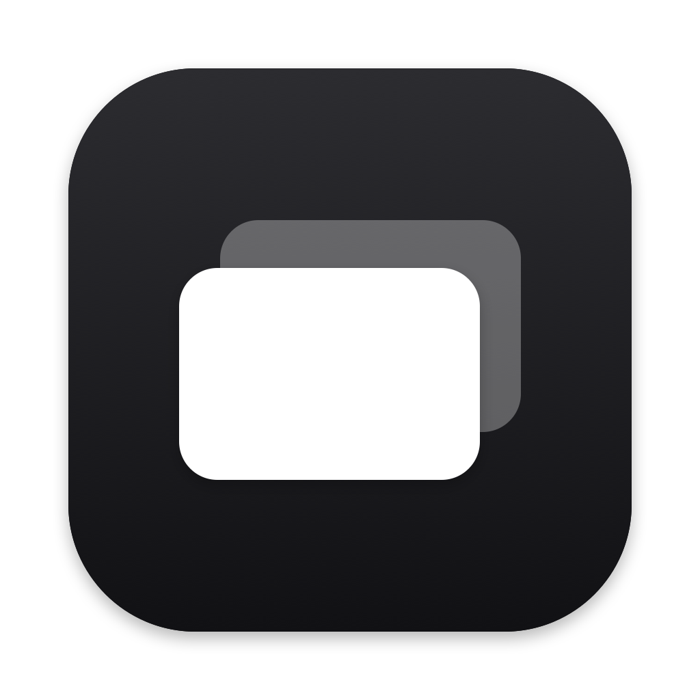
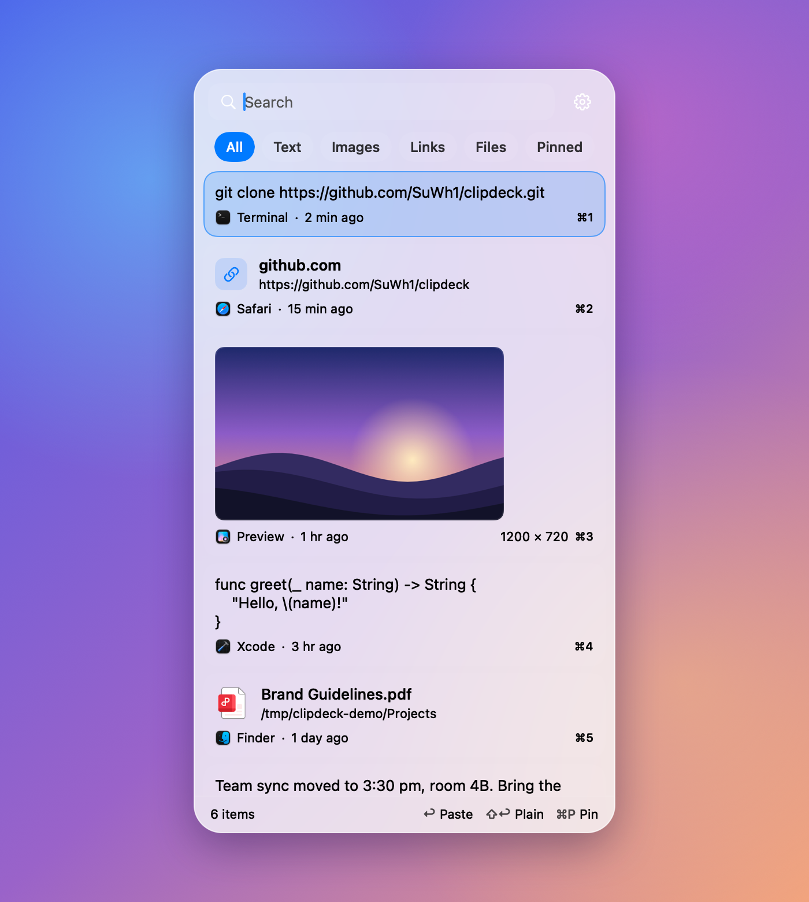

<p align="center">
  
</p>

<h1 align="center">Clipdeck</h1>

<p align="center">
  <b>A free, open-source clipboard manager for Mac.</b><br>
  Everything you copy (text, links, images and files) is one shortcut away.
</p>

<p align="center">
  <a href="https://github.com/SuWh1/clipdeck/releases/latest"></a>
  
  
  <a href="LICENSE"></a>
</p>

<p align="center">
  
</p>

Clipdeck saves your clipboard history on your Mac. Press **⌃⇧⌘V** in any app and a glass panel opens at the top right of the screen with everything you copied. Search it, filter it by type, and press Return to paste.

It is a small, native macOS app written in Swift (AppKit and SwiftUI). It uses liquid glass on macOS 26 and lives in the menu bar. It has no account, no subscription and no tracking, and it never connects to the internet. It is a free alternative to clipboard managers like Paste, PasteNow and Maccy.

## Features

- **Clipboard history** for text, rich text, links, images, screenshots and files.
- **One shortcut**: ⌃⇧⌘V by default. You can set any shortcut in Settings.
- **Instant search** that ignores case and accents and works in any language.
- **Filters**: All, Text, Images, Links, Files and Pinned.
- **Paste anywhere**: pick an item and it is pasted into the app you were using. ⇧↩ pastes as plain text, and ⌘1 to ⌘9 paste the first nine items.
- **Your look**: Auto, Light or Dark, eight accent colors, and a transparency slider from solid to glass.
- **Pins** keep an item forever.
- **Private by design**: copies from password managers are never saved, and you can add any app to an ignore list.
- **History length** of a day, a week, a month (the default), 3 months, a year or forever.
- **PasteNow import**: bring your old history with you.
- **Menu bar app**: it starts at login and has no Dock icon. The panel opens on the screen your mouse is on. You can drag it anywhere, and it opens in that spot on every screen.

## Install

You need macOS 14 Sonoma or later, on an Apple silicon or Intel Mac.

1. Download **[Clipdeck.zip](https://github.com/SuWh1/clipdeck/releases/latest/download/Clipdeck.zip)** from the [latest release](https://github.com/SuWh1/clipdeck/releases/latest).
2. Open the zip and drag **Clipdeck.app** to your **Applications** folder.
3. Open Clipdeck. Clipdeck is not notarized by Apple, so the first time macOS says it cannot check the app. Click **Done**, then open **System Settings › Privacy & Security**, scroll down and click **Open Anyway** next to Clipdeck.

   Or run this once in Terminal, and Clipdeck opens normally:

   ```sh
   xattr -dr com.apple.quarantine /Applications/Clipdeck.app
   ```

## Set up

Clipdeck opens its Settings the first time it starts. Do these two things:

1. **Allow pasting.** Clipdeck needs Accessibility access to paste into other apps. Click **Allow…** in Settings, or open **System Settings › Privacy & Security › Accessibility** and turn on **Clipdeck**. Until you do, Clipdeck copies the item and you press ⌘V yourself.
2. **Pick your shortcut** (optional). Click the shortcut in Settings and press the keys you want, for example ⇧⌘V.

Clipdeck turns on **Open at login** for you. You can turn it off in Settings.

Now copy something and press your shortcut.

## How to use it

| Keys | Action |
|---|---|
| ⌃⇧⌘V | Open or close the history (change it in Settings) |
| Type | Search |
| ↑ ↓ | Select an item |
| ↩ | Paste the selected item |
| ⇧↩ | Paste as plain text |
| ⌘↩ | Copy without pasting |
| ⌘1 … ⌘9 | Paste one of the first nine items |
| Tab, ⇧Tab | Next or previous filter |
| ⌘P | Pin or unpin |
| ⌘⌫ | Delete the selected item |
| Esc | Clear the search, then close |
| ⌘, | Settings |

You can also click an item, or right-click it for more actions. Click the menu bar icon to open the history. Right-click the icon to pause recording, open Settings or quit.

## Import from PasteNow

Open **Settings › History › Import from PasteNow…** and choose `PasteNow.sqlite`. Or run:

```sh
/Applications/Clipdeck.app/Contents/MacOS/Clipdeck --import-pastenow ~/path/to/PasteNow.sqlite
```

Without a path, it reads PasteNow's own data folder. Clipdeck keeps the original copy times, and importing twice does not create duplicates. Images that PasteNow kept in its `.PasteNow_SUPPORT` folder are imported only when that folder sits next to the `.sqlite` file.

## Privacy

- Your history never leaves your Mac. It is stored in `~/Library/Application Support/Clipdeck` (`history.sqlite` and an `images` folder), and only your user account can read it.
- Copies that apps mark as private are never saved. 1Password, Bitwarden, KeePassXC and most password managers mark their copies this way (see [nspasteboard.org](http://nspasteboard.org)).
- Keychain Access, Passwords and common password managers are on the ignore list from the start.
- **Pause recording** (right-click the menu bar icon) stops all saving until you turn it back on.
- Clipdeck checks which app is in front about four times a second. If you copy in an ignored app and switch away within that moment, the copy can still be saved, unless the app marked it as private.
- When you delete an item, its text is overwritten in the database. Image files are deleted the normal way.
- The history panel shows up in screen sharing like any other window. Close it or pause recording while you share your screen.

## Update

Download the new release and replace the app in Applications. macOS then forgets the Accessibility permission, because Clipdeck is not signed with an Apple developer certificate. Open **System Settings › Privacy & Security › Accessibility**, select Clipdeck, remove it with **−**, and allow it again from Clipdeck's Settings.

## Uninstall

Quit Clipdeck from its menu bar icon, then:

```sh
rm -rf /Applications/Clipdeck.app ~/Library/Application\ Support/Clipdeck
defaults delete dev.clipdeck.Clipdeck
```

The second line deletes your clipboard history too.

## FAQ

**macOS says Clipdeck "cannot be opened" or "Apple could not verify" it.** Clipdeck is free and is not notarized, which needs a paid Apple developer account. Use **Open Anyway** as shown in [Install](#install), or build it yourself from the source.

**Pasting does not work.** Clipdeck needs Accessibility access. See [Set up](#set-up). After an update, remove Clipdeck from the Accessibility list and allow it again.

**Photos copied in Telegram show up as files.** Telegram copies a link to a file in its own folder, and macOS keeps other apps out of that folder. To save these photos as images, turn on Clipdeck in **System Settings › Privacy & Security › Full Disk Access**.

**My shortcut does nothing.** Another app may use the same shortcut. Pick a different one in Settings.

**How much history does it keep?** A month by default. "Forever" keeps up to 10,000 items. Pinned items are always kept.

**Can I open the panel from Raycast, Alfred or Shortcuts?** Yes. Run `/Applications/Clipdeck.app/Contents/MacOS/Clipdeck --show`. Any app on your Mac can open the panel this way, but no other app can read your history.

## Build from source

You need Xcode 16 or later. Xcode 26 or later builds the liquid glass design; older versions use the system blur.

```sh
git clone https://github.com/SuWh1/clipdeck.git
cd clipdeck
make install
```

`make install` builds the app, copies it to `/Applications` and starts it.

## Development

```sh
make test       # unit and integration tests (Swift Testing)
make coverage   # coverage report for ClipdeckCore
make app        # build dist/Clipdeck.app
make universal  # build for Apple silicon and Intel
make e2e        # run the built app with a throwaway history and check real copies end to end
make install    # build, copy to /Applications and start
make icon       # redraw the app icon
```

`make e2e` uses your real clipboard while it runs and puts your text back at the end.

The code has two parts:

- `Sources/ClipdeckCore`: the clipboard classifier, the SQLite history store, search, retention, shortcuts, preferences and the PasteNow importer. All of it is covered by tests.
- `Sources/Clipdeck`: the app itself, with the menu bar item, the global shortcut, the glass panel, the settings page and pasting.

Pushing a `v*` tag builds a universal app and publishes it as a GitHub release.

Issues and pull requests are welcome. Please run `make test` before you open a pull request.

## License

[MIT](LICENSE). Free to use, change and share.
